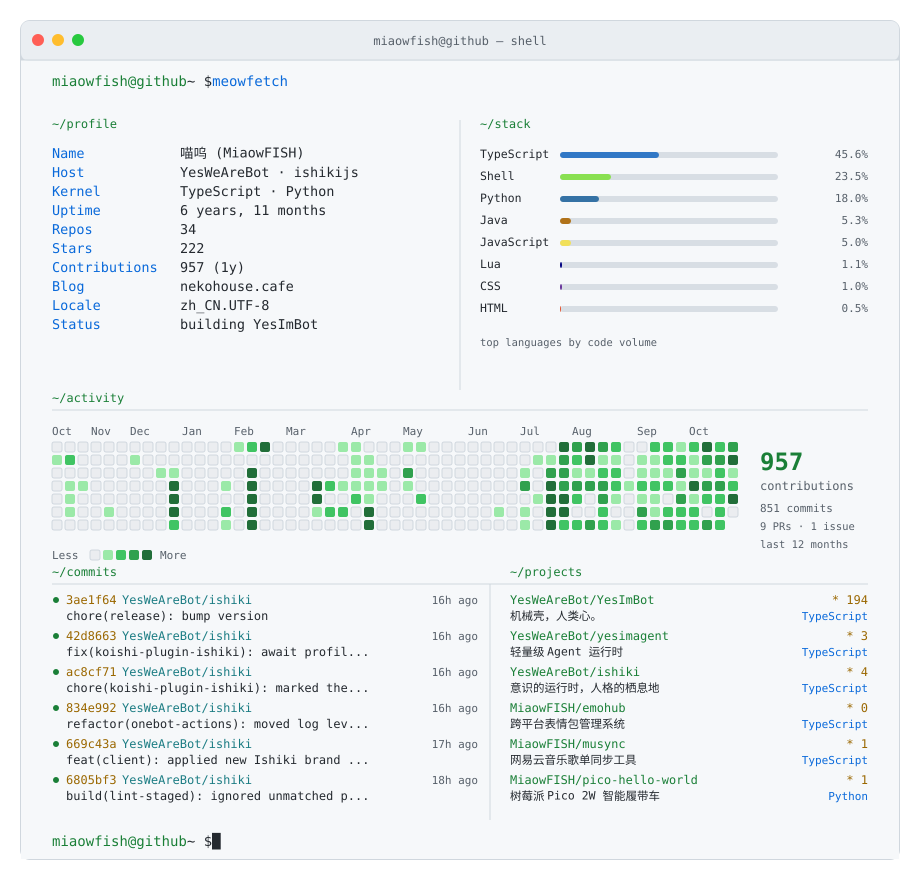

<!-- 卡片由 .github/workflows/refresh.yml 每日生成，请勿手动修改 assets/ 下的 SVG。 -->

  <picture>
    <source media="(prefers-color-scheme: dark)" srcset="./assets/dashboard-dark.svg">
    
  </picture>

  <a href="https://nekohouse.cafe/">blog</a> ·
  <a href="https://github.com/YesWeAreBot">YesWeAreBot</a> ·
  <a href="https://github.com/ishikijs">ishikijs</a>

  

